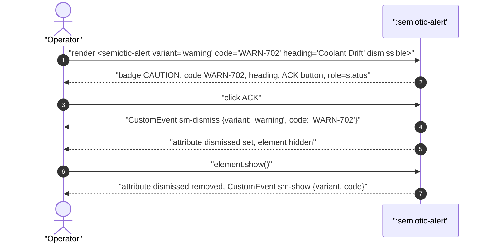
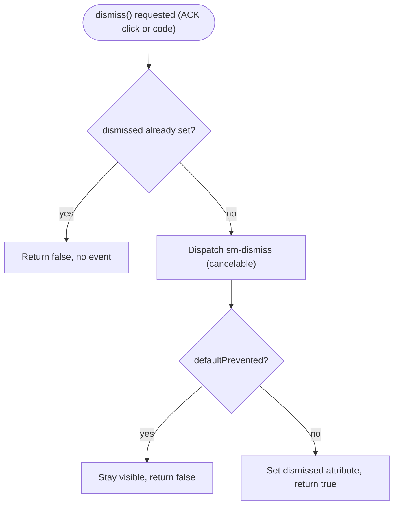
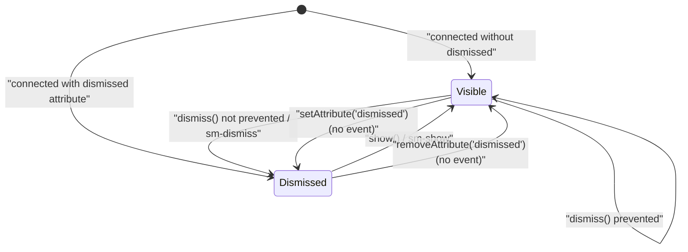

# UC-alert_dismiss: Mostrar, Cerrar y Restaurar una Alerta Técnica

> **Trazabilidad SDD:** Funcionalidad de línea base anterior a seb-harness, creada a partir del prompt fundacional (`prompt_de_inicializaci_n_semiotic_ui.md`, Tarea 1, commit `12ff178`). No tiene spec funcional propia; su comportamiento quedó fijado por los tests de línea base de `specs/001_suite_calidad_tests_lint_spec.md` (Requisitos: `001-RF-06`, `001-RF-07`, `001-RF-08`, `001-RF-09`, `001-RF-10`) y su inventario (atributos, eventos, partes y slots) por `002-RF-16` (`specs/002_coherencia_documento_diseno_spec.md`).
>
> **Revisión:** 2026-11-19 — Creación inicial. Los métodos `show()`, el evento `sm-show` y la propiedad `role` se documentan a partir del código (`src/components/semiotic-alert.js`) y no están cubiertos por un requisito `RF` propio.

## 1. Ficha de Intención

- **ID:** UC-alert_dismiss
- **Actor Principal:** Usuario final de la interfaz (operador) y, en segundo término, el código del consumidor (JavaScript, HTMX o plantilla Thymeleaf) que controla la alerta.
- **Disparador:** El usuario pulsa el botón `ACK` (parte `close-button`), o el código invoca `element.dismiss()` / `element.show()`, o modifica el atributo `dismissed`.
- **Precondiciones:**
  - `<semiotic-alert>` está definido en el registro (ver UC-package_import_bundler o UC-package_load_script).
  - Para que el usuario pueda cerrarla, la alerta tiene el atributo `dismissible`.
- **Invariantes de Negocio:**
  - **Variantes:** `variant` acepta `info`, `success`, `warning`, `danger`; cualquier otro valor se comporta como `info` (`001-RF-07`). Cada variante muestra una etiqueta canónica en la parte `badge`: `INFO`, `NOMINAL`, `CAUTION`, `ALERT`.
  - **Accesibilidad:** la variante `danger` expone `role="alert"`; las demás, `role="status"` (vía `ElementInternals` o atributo `role` como respaldo). El botón de cierre usa `close-label` como `aria-label` (por defecto `Dismiss alert`).
  - **Contenido seguro:** los atributos de texto renderizados (`code`, `heading`, `close-label`) se insertan como texto literal; un valor con marcado HTML no crea elementos en el Shadow DOM (`001-RF-10`).
  - **Encabezado:** el slot `heading` tiene prioridad sobre el atributo `heading`.
  - **Cierre cancelable:** cerrar emite `sm-dismiss` con `bubbles`, `composed` y `cancelable` en `true` y `detail: { variant, code }` (`001-RF-08`); si un listener invoca `preventDefault()`, la alerta permanece visible y sin atributo `dismissed` (`001-RF-09`).
  - **Compatibilidad con atributos HTML:** todo el estado se refleja en atributos (`dismissed`, `variant`, etc.), por lo que es controlable desde `th:attr` o desde swaps de HTMX sin JavaScript propio.

## 2. Diagrama de Interacción del Sistema (SSD)

## 3. Árbol de Decisiones

## 4. Diagrama de Estados

## 5. Caminos Alternativos y Catálogo de Errores

El componente no lanza excepciones ni emite códigos de error; los identificadores son nominales.

| Error Code | Causa Raíz | Respuesta / Efecto |
| :--- | :--- | :--- |
| `INVALID_VARIANT` | `variant` con valor fuera del conjunto permitido | Se comporta como `info` (`001-RF-07`) |
| `DISMISS_PREVENTED` | Un listener de `sm-dismiss` invoca `preventDefault()` | La alerta permanece visible; `dismiss()` devuelve `false` (`001-RF-09`) |
| `ALREADY_DISMISSED` | `dismiss()` sobre una alerta ya cerrada | Sin evento; devuelve `false` |
| `NOT_DISMISSED` | `show()` sobre una alerta visible | Sin evento ni cambios |
| `NOT_DISMISSIBLE` | Falta el atributo `dismissible` | No se muestra el botón `ACK`; el cierre solo es posible por código |
| `HTML_IN_TEXT_ATTRIBUTE` | `code`, `heading` o `close-label` con marcado HTML | Se renderiza como texto literal (`001-RF-10`) |
| `ATTRIBUTE_TOGGLE` | El consumidor quita o pone `dismissed` directamente | Cambia la visibilidad sin emitir `sm-dismiss` ni `sm-show` |

## 6. Postcondiciones y Efectos Secundarios

- **Estado Persistido:** Ninguno fuera del DOM. El estado vive en el atributo `dismissed` y, si el navegador lo soporta, en los estados personalizados `:state(dismissed)` y `:state(dismissible)`.
- **Eventos Emitidos:** `sm-dismiss` (cancelable, burbujea y atraviesa el Shadow DOM) y `sm-show` (no cancelable), ambos con `detail: { variant, code }`. Son `CustomEvent` estándar, escuchables con `addEventListener` o con `hx-trigger="sm-dismiss"` en HTMX.
- **Auditoría:** Ninguna en runtime. Verificado por `tests/components/semiotic-alert/*.test.js`.
