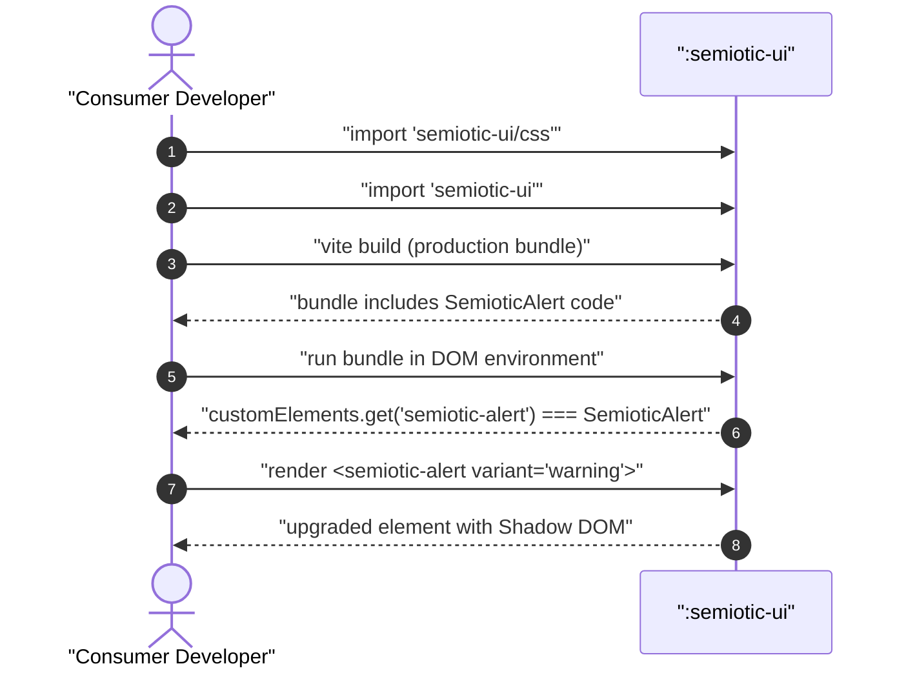
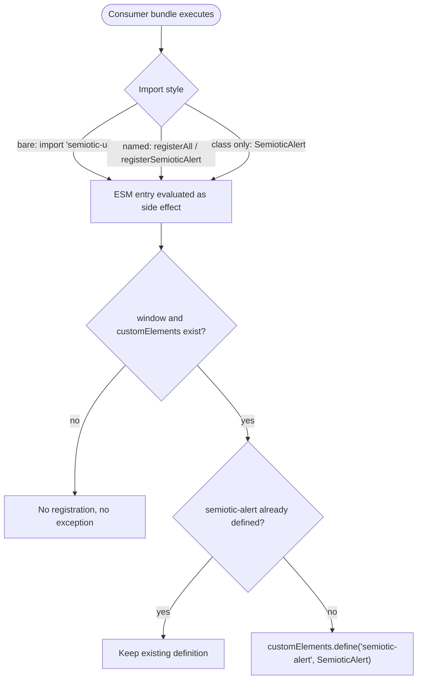

# UC-package_import_bundler: Consumir el Paquete desde una Aplicación con Bundler

> **Trazabilidad SDD:** Derivado de la spec `specs/003_autoregistro_import_bare_spec.md` (Requisitos: `003-RF-01`, `003-RF-02`, `003-RF-03`, `003-RF-04`, `003-RF-07`; Casos límite: `003-CL-01`, `003-CL-02`; Historia: `003-HU-01`).
>
> **Revisión:** 2026-11-19 — Creación inicial a partir de la Spec 003 verificada (`seb verify` aprobado, commit `1918c3e`).

## 1. Ficha de Intención

- **ID:** UC-package_import_bundler
- **Actor Principal:** Desarrollador consumidor que integra `semiotic-ui` en una aplicación construida con Vite (motor Rollup): React, Astro o Vite plano.
- **Disparador:** El código del consumidor contiene `import 'semiotic-ui'` (import bare) o importa exports con nombre (`registerAll`, `registerSemioticAlert`, `SemioticAlert`), y el consumidor ejecuta la compilación de producción del bundler.
- **Precondiciones:**
  - El paquete está instalado en el proyecto consumidor, ya sea como paquete empaquetado (`npm pack` / registro) o como enlace local por ruta.
  - El especificador `semiotic-ui` resuelve al artefacto ESM `dist/semiotic-ui.es.js` vía `package.json#exports["."].import`.
  - La hoja de estilos se importa por separado con `import 'semiotic-ui/css'` (el import bare no la carga; ver Fuera de Alcance de la Spec 003).
- **Invariantes de Negocio:**
  - Importar el paquete por su nombre es suficiente para que `<semiotic-alert>` quede definido en `customElements` al ejecutar el bundle en un entorno con DOM; el consumidor no invoca ninguna función de registro (`003-RF-02`).
  - El tree-shaking del bundler no elimina el código del Custom Element en un import bare, porque `package.json#sideEffects` declara `./dist/*.js` como módulos con efectos (`003-RF-01`).
  - El registro es idempotente: múltiples importaciones o una invocación explícita previa no lanzan excepción y conservan la definición existente (`003-RF-04`, `003-CL-01`).
  - La API pública permanece estable: exports `registerAll`, `registerSemioticAlert`, `SemioticAlert`; artefactos `semiotic-ui.es.js`, `semiotic-ui.umd.js`, `semiotic-ui.css`; global UMD `SemioticUI`; especificadores `semiotic-ui`, `semiotic-ui/css`, `semiotic-ui/tokens.css` (`003-RF-07`).

## 2. Diagrama de Interacción del Sistema (SSD)

## 3. Árbol de Decisiones

El comportamiento observable es el mismo para las tres formas de importación; el árbol muestra cómo cada una converge en un registro único.

## 4. Caminos Alternativos y Catálogo de Errores

La librería no emite códigos de error propios; los identificadores de la primera columna son nominales para referencia documental.

| Error Code | Causa Raíz | Respuesta / Efecto |
| :--- | :--- | :--- |
| `ALREADY_DEFINED` | El paquete se importa más de una vez en el mismo bundle (bare + con nombre) o el consumidor llamó antes a `registerAll()` | Carga completa sin excepción; se conserva la definición existente (`003-RF-04`, `003-CL-01`) |
| `CLASS_ONLY_IMPORT` | El consumidor importa solo `SemioticAlert` sin invocar el registro | El auto-registro igualmente deja la etiqueta definida (`003-CL-02`) |
| `NO_DOM_ENVIRONMENT` | El bundle se evalúa en un entorno sin `window` / `customElements` | Importación sin excepción y sin registro; ver UC-package_import_ssr |
| `UNSUPPORTED_BUNDLER` | Uso de webpack, esbuild u otro bundler distinto de Vite/Rollup | Sin garantía verificada; fuera de alcance de la Spec 003 |
| `STYLES_MISSING` | El consumidor no importa `semiotic-ui/css` | El elemento se registra, pero las clases `.sm-*` y los tokens globales no se aplican; los fallbacks internos del Shadow DOM mantienen legible la alerta |

## 5. Postcondiciones y Efectos Secundarios

- **Estado Persistido:** Ninguno. El único efecto es la entrada `semiotic-alert` en el `CustomElementRegistry` del documento.
- **Eventos Emitidos:** Ninguno durante el registro. Los eventos del componente (`sm-dismiss`, `sm-show`) se documentan en UC-alert_dismiss.
- **Auditoría:** Ninguna en runtime. La garantía se verifica con `tests/package/consumer-bare-import.test.js`, `tests/package/consumer-named-imports.test.js`, `tests/package/registration-idempotence.test.js` y `tests/package/public-api.test.js`.
