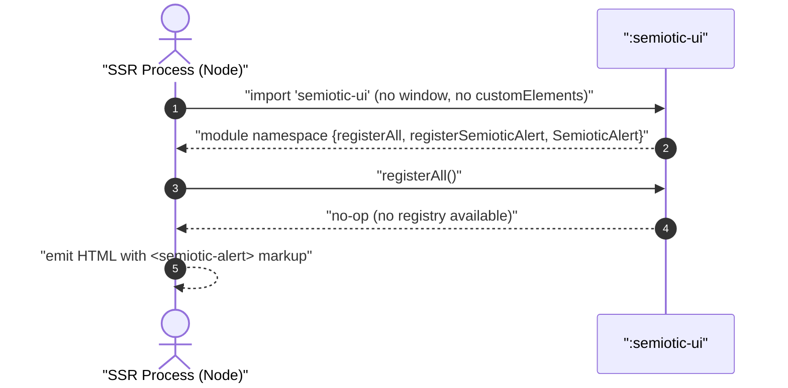

# UC-package_import_ssr: Importar el Paquete en un Proceso de Renderizado en Servidor

> **Trazabilidad SDD:** Derivado de la spec `specs/003_autoregistro_import_bare_spec.md` (Requisitos: `003-RF-05`; Historia: `003-HU-03`). Comportamiento de línea base sobre el código fuente asegurado además por `001-RF-05` (`specs/001_suite_calidad_tests_lint_spec.md`).
>
> **Revisión:** 2026-11-19 — Creación inicial a partir de la Spec 003 verificada (commit `1918c3e`).

## 1. Ficha de Intención

- **ID:** UC-package_import_ssr
- **Actor Principal:** Proceso de renderizado en servidor (SSR) ejecutado en Node.js, por ejemplo el build o el servidor de Astro.
- **Disparador:** Evaluación de `import 'semiotic-ui'` (punto de entrada ESM) o `require('semiotic-ui')` (punto de entrada UMD) en un entorno sin `window`, `document` ni `customElements`.
- **Precondiciones:**
  - El paquete está instalado en el proyecto que ejecuta el SSR.
- **Invariantes de Negocio:**
  - La importación termina sin `ReferenceError` ni ninguna otra excepción, por ambos puntos de entrada (`003-RF-05`).
  - No se registra ningún componente: el auto-registro solo ocurre si existen `window` y `customElements`.
  - La clase `SemioticAlert` es importable aunque no exista `HTMLElement` (se usa una clase base vacía), y su plantilla de Shadow DOM se construye de forma perezosa solo cuando hay `document`.
  - El HTML generado en servidor con `<semiotic-alert ...>` se actualiza en el cliente cuando allí se carga el paquete (ver UC-package_import_bundler o UC-package_load_script).

## 2. Diagrama de Interacción del Sistema (SSD)

## 3. Árbol de Decisiones (Opcional)

Flujo lineal; no requiere árbol de decisiones.

## 4. Caminos Alternativos y Catálogo de Errores

| Error Code | Causa Raíz | Respuesta / Efecto |
| :--- | :--- | :--- |
| `NO_DOM_ENVIRONMENT` | Ausencia de `window`, `document` y `customElements` | Importación exitosa sin registro (camino principal de este caso de uso) |
| `CSS_IMPORT_IN_NODE` | Importar `src/index.js` directamente en Node sin bundler | Falla por los `import` de archivos `.css`; los consumidores deben usar los artefactos de `dist/` vía el especificador del paquete |

## 5. Postcondiciones y Efectos Secundarios

- **Estado Persistido:** Ninguno.
- **Eventos Emitidos:** Ninguno.
- **Auditoría:** Ninguna en runtime. Verificado por `tests/package/ssr-entry-points.test.js` y `tests/ssr/import-without-dom.test.js`.
