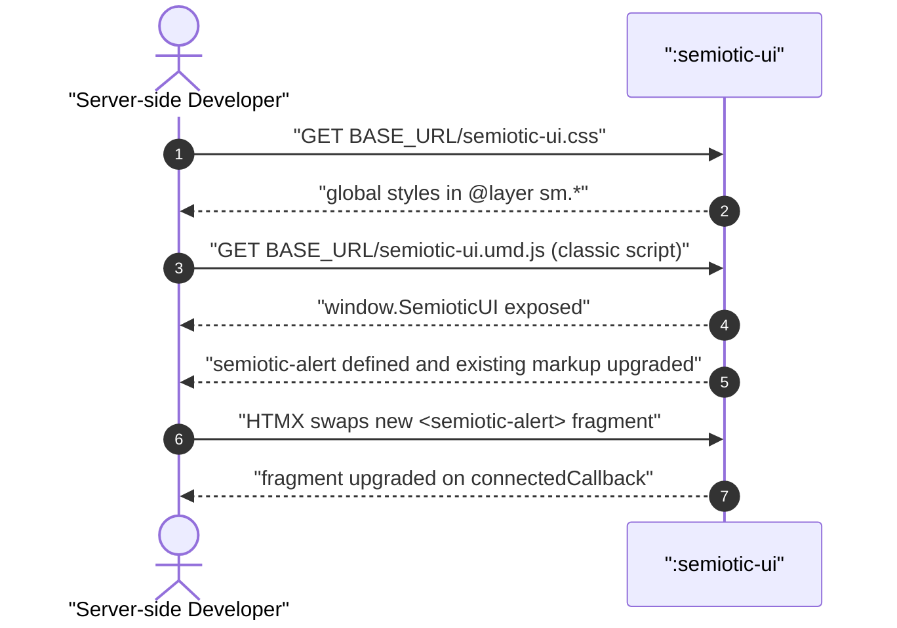

# UC-package_load_script: Cargar la Librería con Script Clásico (CDN, Thymeleaf, HTMX)

> **Trazabilidad SDD:** Derivado de la spec `specs/003_autoregistro_import_bare_spec.md` (Requisitos: `003-RF-06`, `003-RF-04`, `003-RF-07`; Historia: `003-HU-02`).
>
> **Revisión:** 2026-11-19 — Creación inicial a partir de la Spec 003 verificada (commit `1918c3e`).

## 1. Ficha de Intención

- **ID:** UC-package_load_script
- **Actor Principal:** Desarrollador consumidor sin bundler que sirve HTML desde el servidor (Java Thymeleaf, HTMX o HTML estático).
- **Disparador:** El navegador procesa en la plantilla las etiquetas `<link rel="stylesheet" href="BASE_URL/semiotic-ui.css">` y `<script src="BASE_URL/semiotic-ui.umd.js" defer>`.
- **Precondiciones:**
  - Los artefactos `semiotic-ui.css` y `semiotic-ui.umd.js` están publicados en un CDN o en los estáticos del proyecto.
  - El script se carga como script clásico, sin sistema de módulos (`type="module"` no es necesario).
- **Invariantes de Negocio:**
  - Cargar el artefacto UMD deja `<semiotic-alert>` definido sin ninguna invocación adicional (`003-RF-06`).
  - El script expone el global `SemioticUI` con los exports `registerAll`, `registerSemioticAlert` y `SemioticAlert` (`003-RF-07`).
  - El HTML renderizado en servidor antes de la carga del script se actualiza (upgrade) al definirse el elemento: atributos como `variant`, `code`, `heading` y `dismissible` emitidos por `th:attr` o por fragmentos HTMX se leen en `connectedCallback`.
  - Una invocación posterior de `SemioticUI.registerAll()` es inocua (`003-RF-04`).

## 2. Diagrama de Interacción del Sistema (SSD)

## 3. Árbol de Decisiones (Opcional)

Flujo lineal; no requiere árbol de decisiones.

## 4. Caminos Alternativos y Catálogo de Errores

La librería no emite códigos de error propios; los identificadores son nominales.

| Error Code | Causa Raíz | Respuesta / Efecto |
| :--- | :--- | :--- |
| `ALREADY_DEFINED` | El script se incluye dos veces o el consumidor invoca `SemioticUI.registerAll()` | Sin excepción; se conserva la definición existente (`003-RF-04`) |
| `SCRIPT_NOT_LOADED` | Ruta incorrecta o bloqueo de red del artefacto UMD | El marcado `<semiotic-alert>` permanece como elemento desconocido y muestra su contenido de texto plano; las clases `.sm-*` siguen funcionando si el CSS cargó |
| `STYLESHEET_NOT_LOADED` | Falta el `<link>` a `semiotic-ui.css` | Clases `.sm-*` sin estilo; la alerta conserva su apariencia por los fallbacks internos de su Shadow DOM |

## 5. Postcondiciones y Efectos Secundarios

- **Estado Persistido:** Ninguno.
- **Eventos Emitidos:** Ninguno durante la carga. Los eventos del componente se documentan en UC-alert_dismiss.
- **Auditoría:** Ninguna en runtime. Verificado por `tests/package/umd-classic-script.test.js`.
