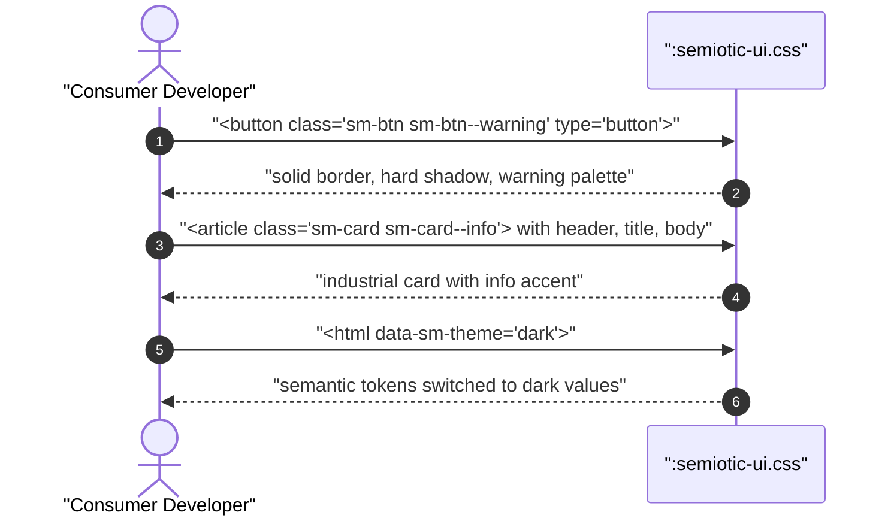

# UC-styles_apply_classes: Maquetar Componentes sin Estado con Clases CSS Semánticas

> **Trazabilidad SDD:** Funcionalidad de línea base anterior a seb-harness, creada a partir del prompt fundacional (`prompt_de_inicializaci_n_semiotic_ui.md`, Tarea 1, commit `12ff178`). No tiene spec funcional propia. El estado del CSS quedó congelado por `001-RF-21` y `001-RF-26`, sus reglas estéticas son controladas por el lint (`001-RF-13` a `001-RF-18`) y su inventario por `002-RF-12` y `002-RF-13`.
>
> **Revisión:** 2026-11-19 — Creación inicial a partir del código (`src/css/*.css`).

## 1. Ficha de Intención

- **ID:** UC-styles_apply_classes
- **Actor Principal:** Desarrollador consumidor que escribe marcado HTML, JSX o plantillas Thymeleaf.
- **Disparador:** El navegador renderiza elementos con clases `.sm-*` en una página que cargó `semiotic-ui.css` (o `semiotic-ui/css` vía bundler).
- **Precondiciones:**
  - La hoja de estilos de la librería está cargada.
- **Invariantes de Negocio:**
  - **CSS-First:** botones, tarjetas y etiquetas técnicas se resuelven solo con clases; no requieren JavaScript.
  - **Clases disponibles:** `.sm-btn` con modificadores `--primary`, `--info`, `--success`, `--warning`, `--danger`, `--ghost`, `--sm`, `--lg`; `.sm-card` con elementos `.sm-card-header`, `.sm-card-title`, `.sm-card-body`, `.sm-card-footer` y modificadores `--info`, `--success`, `--warning`, `--danger`, `--compact`; `.sm-code-tag` para etiquetas técnicas (`SEC-04`, `DOC-00 // V0.1.0`).
  - **Estética Semiotic Standard:** bordes sólidos, radio cero o de la escala permitida, sombras duras sin difuminado y colores solo a través de tokens `--sm-*` (garantizado por el lint de `001-RF-13` a `001-RF-18`).
  - **Cascada predecible:** todo el CSS vive en `@layer sm.reset, sm.tokens, sm.base, sm.components`; el CSS del consumidor fuera de capas siempre tiene prioridad.
  - **Temas:** el tema oscuro se activa con `:root[data-sm-theme='dark']` o con la clase `.sm-theme-dark` en un contenedor, redefiniendo tokens semánticos.
  - **No existen en esta versión:** `.sm-badge`, `.sm-input` ni otros controles de formulario (`badges.css` y `forms.css` del prompt fundacional están pendientes de spec).

## 2. Diagrama de Interacción del Sistema (SSD)

## 3. Árbol de Decisiones (Opcional)

Flujo lineal; no requiere árbol de decisiones.

## 4. Caminos Alternativos y Catálogo de Errores

| Error Code | Causa Raíz | Respuesta / Efecto |
| :--- | :--- | :--- |
| `UNKNOWN_CLASS` | Uso de una clase inexistente (por ejemplo `.sm-badge`) | Sin estilo; el documento de diseño la declara como inexistente |
| `CONSUMER_RESET_OVERRIDE` | Un reset global del consumidor fuera de capas (por ejemplo `button { all: unset; }`) | Anula los estilos `.sm-*`; se mitiga declarando el reset en una capa anterior a las capas `sm` |
| `STYLESHEET_NOT_LOADED` | No se cargó `semiotic-ui.css` | Las clases no producen ningún efecto |

## 5. Postcondiciones y Efectos Secundarios

- **Estado Persistido:** Ninguno.
- **Eventos Emitidos:** Ninguno.
- **Auditoría:** Ninguna en runtime. Calidad controlada por `npm run lint:css` y por la comprobación de coherencia de `DESIGN.md` dentro de `npm test`.
